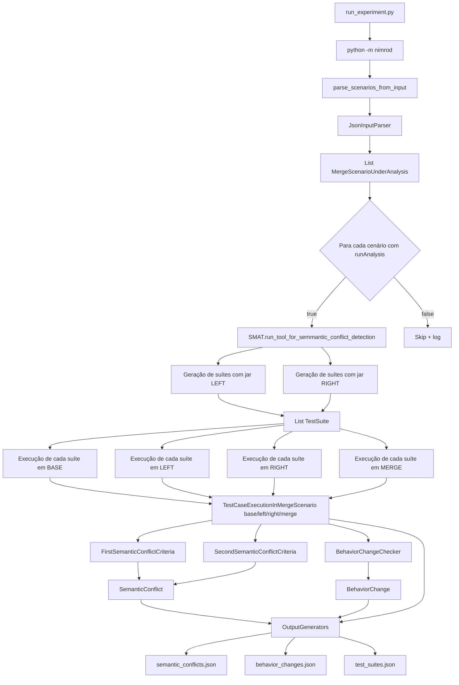

# Fluxo de análise de merge do SMAT-LLM

Este documento descreve, em nível de engenharia, como o projeto analisa um
cenário de merge e detecta interferências (conflitos semânticos) por meio de
testes gerados e executados dinamicamente. O foco é a versão do branch `main`
deste repositório, cujo entrypoint é `run_experiment.py` → `python -m nimrod`.

## 1. Resposta direta

**Sim**, o projeto analisa um cenário de merge e verifica a ocorrência de
interferências. Ele gera testes automaticamente e compara o resultado de cada
teste nas quatro versões do cenário (`base`, `left`, `right` e `merge`).

**Porém, os testes não são criados nas quatro versões.** No pipeline principal
(`nimrod/smat.py`), os testes são gerados **duas vezes por gerador: uma a partir
do artefato `left` e outra a partir do artefato `right`**. As duas suítes são
então **executadas** contra `base`, `left`, `right` e `merge`.

| Versão | Fonte para geração | Jar para geração | Execução dos testes | Papel na detecção |
|---|---|---|---|---|
| `base` | Não (opcional; ver nota) | Não | Sim | Ancestral comum; referência de comportamento |
| `left` | Sim | Sim | Sim | Um dos pais do merge |
| `right` | Sim | Sim | Sim | O outro pai do merge |
| `merge` | Não (opcional; ver nota) | Não | Sim | Resultado da integração |

Notas:

- `evosuite-differential` usa `base` como *regression classpath* durante a
  geração, mas a suíte continua sendo gerada a partir de `left` ou `right`
  (`nimrod/test_suite_generation/generators/evosuite_differential_test_suite_generator.py:19`).
- O gerador `project` não cria testes: ele reutiliza os testes já existentes no
  merge (`...-TestFiles.jar` + arquivo `.txt` com os nomes das classes)
  (`nimrod/test_suite_generation/generators/project_test_suite_generator.py:16`).
- O fluxo legado em `nimrod/setup_tools/setup_tool.py` segue a mesma ideia:
  gera a suíte a partir de um pai (`left` ou `right`) e executa em
  `base`, pai, outro pai e `merge`.
- Existe também um fluxo opcional de pré-análise com Laya, executado antes da
  detecção dinâmica. Ele levanta hipóteses sobre os três critérios de estado do
  artigo e não substitui a detecção por execução. Ver `docs/fluxo-laya.md`.

## 2. Visão geral do pipeline



## 3. Mapa dos módulos

| Caminho | Responsabilidade |
|---|---|
| `run_experiment.py` | Ajusta `PYTHONPATH`/`JAVA_HOME` e executa `python -m nimrod`. |
| `SMAT/nimrod/__main__.py` | Composition root: lê config, instancia geradores, análise e saídas; percorre os cenários. |
| `SMAT/nimrod/input_parsing/input_parser.py` | Converte JSON/CSV no modelo interno `MergeScenarioUnderAnalysis`. |
| `SMAT/nimrod/core/merge_scenario_under_analysis.py` | Modelo do cenário: projeto, commits, `targets`, jars e `jarType`. |
| `SMAT/nimrod/smat.py` | Orquestra geração → execução → análise → relatórios. |
| `SMAT/nimrod/test_suite_generation/main.py` | Itera os geradores configurados e compila as suítes. |
| `SMAT/nimrod/test_suite_generation/generators/` | Geradores: LLM, Randoop, Evosuite, Evosuite diferencial e `project`. |
| `SMAT/nimrod/test_suites_execution/main.py` | Executa cada suíte nas quatro versões e consolida os resultados por teste. |
| `SMAT/nimrod/test_suites_execution/test_suite_executor.py` | Roda JUnit, detecta `PASS`/`FAIL`/`NOT_EXECUTABLE` e instabilidade (`FLAKY`). |
| `SMAT/nimrod/dynamic_analysis/main.py` | Aplica os critérios de conflito e detecta mudanças de comportamento. |
| `SMAT/nimrod/dynamic_analysis/criteria/` | Implementações dos critérios de conflito semântico. |
| `SMAT/nimrod/output_generation/` | Gera os relatórios JSON. |
| `SMAT/nimrod/setup_tools/` | Pipeline legado de geração/execução (não é o entrypoint atual). |
| `SMAT/nimrod/tools/` | Wrappers de Java, JUnit, Jacoco, Evosuite, Randoop etc. |

## 4. Fluxo detalhado

### 4.0 Flags de habilitação

O SMAT tem dois fluxos independentes:

- `SMAT_DYNAMIC_INTERFERENCE_DETECTION` (padrão `true`): pipeline dinâmico
  descrito neste documento.
- `SMAT_LAYA_INTERFERENCE_DETECTION` (padrão `false`): pré-análise com Laya.

Qualquer combinação é válida: nenhum fluxo, apenas Laya, apenas dinâmico ou os
dois. Quando o fluxo dinâmico está desabilitado, o console exibe
`O fluxo de detecção de interferências baseado em testes não está ativo.`;
quando os dois estão desabilitados, o SMAT informa que nenhum fluxo está ativo.

O guard do fluxo dinâmico existe em dois níveis: `nimrod/__main__.py` (evita o
setup) e `SMAT.run_tool_for_semmantic_conflict_detection` (protege chamadas
programáticas).

### 4.1 Entrada e parsing

1. `run_experiment.py` executa `python -m nimrod` com `cwd=SMAT`.
2. `nimrod/__main__.py:parse_scenarios_from_input` usa `SMAT_INPUT_PATH` (env)
   ou `input_path` do `nimrod/tests/env-config.json`.
3. `JsonInputParser` lê uma lista de cenários. Cada cenário contém:
   - `projectName`
   - `runAnalysis`
   - `scenarioCommits` (`base`, `left`, `right`, `merge`)
   - `targets` (classe → métodos e resumos de mudança)
   - `scenarioJars` (`base`, `left`, `right`, `merge`; vários jars separados por `:`)
   - `jarType` (`transformed` ou `original`)
4. O resultado é uma lista de `MergeScenarioUnderAnalysis`.

### 4.2 Geração de suítes (somente `left` e `right`)

Em `SMAT/nimrod/smat.py:34-39`, `_generate_test_suites_for_scenario` chama:

```python
suites_left = generate_test_suites(scenario, scenario.scenario_jars.left, ...)
suites_right = generate_test_suites(scenario, scenario.scenario_jars.right, ...)
return suites_left + suites_right
```

Para cada jar e cada gerador habilitado, `TestSuiteGeneration.generate_test_suites`
chama `generate_and_compile_test_suite`. A suíte é criada em:

```text
SMAT/output-test-dest/projects/<projeto>/<merge[:6]>/<GERADOR>_<timestamp>/
├── classes/                 # .class compilados
├── *.java                   # testes gerados
├── scenario_infos.json
├── imports.json
├── generated_messages.json
└── llm_outputs/             # respostas brutas do LLM
```

No gerador LLM (`CodellamaTestSuiteGenerator`):

1. O branch é inferido do caminho do jar (`left`/`right`) em
   `fetch_source_code_branch`.
2. As fontes são localizadas em `source/` ao lado de `transformed/` ou
   `original/` (`<Classe>_<branch>.java`, `<Classe>/<branch>.java`,
   `<branch>.java` ou `<Classe>.java`).
3. `extract_class_info` usa Tree-sitter para extrair campos, construtores e o
   método-alvo.
4. `PromptManager.generate_all_combinations` monta 8 combinações de contexto
   (`prompt1` a `prompt8`) para `zero_shot` ou `one_shot`.
5. As respostas são salvas e cada `@Test` é extraído para um arquivo `.java`
   separado.
6. A suíte é compilada com `javac`; falhas vão para
   `reports/compilation_results.json`.

Observação: o `targets` é a fonte de verdade para o que será gerado. Métodos
listados como string ou como objeto (`method`, `leftChangesSummary`,
`rightChangesSummary`) são aceitos.

### 4.3 Execução nas quatro versões

`TestSuitesExecution.execute_test_suites` percorre todas as suítes (geradas a
partir de `left` e de `right`) e executa cada uma em:

```python
base   # scenario_jars.base
left   # scenario_jars.left
right  # scenario_jars.right
merge  # scenario_jars.merge
```

(`SMAT/nimrod/test_suites_execution/main.py:16-24`)

O executor roda cada classe de teste **3 vezes** (`number_of_executions=3`).
Se o resultado variar entre execuções, o teste é marcado como `FLAKY`.

Resultados possíveis (`TestCaseResult`):

| Valor | Significado |
|---|---|
| `PASS` | Teste passou. |
| `FAIL` | Teste falhou. |
| `FLAKY` | Resultado variou entre as execuções. |
| `NOT_EXECUTABLE` | Erro de compilação/linkagem ou teste não executável. |

Os resultados das quatro versões são consolidados em
`TestCaseExecutionInMergeScenario`, que é a unidade analisada:

```python
TestCaseExecutionInMergeScenario(
    test_suite, name, base, left, right, merge
)
```

Importante: `_merge_test_case_results` itera pelas chaves de `results_base`.
Se um teste não aparecer no resultado da execução em `base`, ele não entra na
análise.

### 4.4 Análise dinâmica

`DynamicAnalysis` aplica dois critérios independentes a cada
`TestCaseExecutionInMergeScenario`.

#### FirstSemanticConflictCriteria

Detecta interferência quando o merge acompanha o `base`, mas um dos pais
divergiu:

```text
(base == PASS e merge == PASS) e (left == FAIL ou right == FAIL)
OU
(base == FAIL e merge == FAIL) e (left == PASS ou right == PASS)
```

#### SecondSemanticConflictCriteria

Detecta interferência quando o merge difere do comportamento de `base` e dos
dois pais simultaneamente:

```text
(base == FAIL e left == FAIL e right == FAIL e merge == PASS)
OU
(base == PASS e left == PASS e right == PASS e merge == FAIL)
```

Cada critério satisfeito gera um `SemanticConflict` com o critério e a execução
que o detectou.

#### Mudanças de comportamento

Em paralelo, `BehaviorChangeChecker` compara pares de resultados e registra
`BehaviorChange` quando há transição `PASS ↔ FAIL`:

```text
BASE  ↔ LEFT
BASE  ↔ RIGHT
LEFT  ↔ MERGE
RIGHT ↔ MERGE
```

`NOT_EXECUTABLE` e `FLAKY` não contam como mudança de comportamento.

### 4.5 Geração dos relatórios

Os `OutputGenerator`s recebem um `OutputGeneratorContext` com cenário, suítes,
execuções, conflitos e mudanças de comportamento. Os relatórios ficam em:

```text
SMAT/output-test-dest/reports/
├── semantic_conflicts.json
├── behavior_changes.json
├── test_suites.json
├── compilation_results.json
└── execution_results.json
```

- `semantic_conflicts.json`: um registro por conflito detectado, com
  `criteria`, `test_case_name`, resultados por versão, caminho da suíte e
  `scenario_targets`.
- `behavior_changes.json`: um registro por par com mudança de comportamento.
- `test_suites.json`: resumo por suíte (gerador, caminho, flags de conflito e
  mudança).
- `compilation_results.json`: saída de compilação por arquivo `.java`.
- `execution_results.json`: log bruto das execuções por suíte/jar.

Os relatórios são **anexados** a cada execução (`write_report` faz
`existing_data.append(new_data)`), então execuções repetidas produzem listas
aninhadas. Arquive ou remova `SMAT/output-test-dest` entre experimentos.

### 4.6 Pré-análise com Laya (opcional)

Quando `SMAT_LAYA_INTERFERENCE_DETECTION=true`, o `LayaInterferenceFlow` roda
antes do fluxo dinâmico. Para cada método-alvo ele:

1. resolve os fontes `base`/`left`/`right`/`merge` com
   `nimrod/source_code.py`;
2. extrai campos, construtores e corpo do método com Tree-sitter;
3. monta um estado JSON compacto;
4. pergunta ao Laya três `noul` (um por critério), um `choice` para o critério
   principal, um `choice` para o branch afetado e um `score` de confiança;
5. grava um `.log` legível e um `.jsonl` em `reports/laya/`.

O Laya não executa código; o resultado é uma hipótese de triagem. A detecção
por execução continua sendo a autoridade. Detalhes em `docs/fluxo-laya.md`.

## 5. Modelo de dados resumido

```text
MergeScenarioUnderAnalysis
├── project_name
├── run_analysis
├── scenario_commits : ScenarioInformation(base, left, right, merge)
├── targets          : {classe: [metodo | {method, leftChangesSummary, rightChangesSummary}]}
├── scenario_jars    : ScenarioInformation(base, left, right, merge)
└── jar_type

TestSuite
├── generator_name
├── path
├── class_path
└── test_classes_names

TestCaseExecutionInMergeScenario
├── test_suite
├── name
├── base / left / right / merge : TestCaseResult
```

## 6. Onde uma nova feature pode entrar

| Objetivo | Ponto de extensão |
|---|---|
| Novo critério de interferência | Implementar `SemanticConflictCriteria` e registrar em `nimrod/__main__.py`. |
| Novo gerador de testes | Implementar `TestSuiteGenerator` e adicionar em `get_test_suite_generators`. |
| Nova análise sobre as execuções | Estender `DynamicAnalysis` ou adicionar um novo `OutputGenerator`. |
| Novo formato de entrada | Implementar `InputParser` e usar em `parse_scenarios_from_input`. |
| Gerar testes também em `base`/`merge` | Alterar `SMAT._generate_test_suites_for_scenario`; atenção ao diretório de saída e à deduplicação de suítes. |
| Métricas de cobertura | Reativar o caminho em `SemanticConflictsOutputGenerator` (hoje desativado por um `raise`). |

## 7. Limitações e riscos observados

1. **Geração apenas em `left`/`right`**: não há geração de testes a partir de
   `base` ou `merge` no pipeline principal. Se a feature exigir testes
   originados do merge, isso precisa ser implementado.
2. **Cobertura desativada**: `SemanticConflictsOutputGenerator` lança
   `Exception("Skipping coverage analysis for now.")` de forma incondicional;
   `exercised_targets` fica sempre vazio.
3. **Colisão de diretório de suíte**: `suite_dir` usa apenas nome do gerador +
   `int(time())`. Duas gerações no mesmo segundo (por exemplo, `project` ou
   execuções muito rápidas) podem compartilhar o mesmo diretório.
4. **Base como denominador**: a consolidação parte de `results_base.keys()`;
   testes ausentes na execução em `base` não são analisados.
5. **`FAIL` genérico**: `get_result_for_test_case` retorna `FAIL` para qualquer
   falha que não seja classificada como problema de compilação.
6. **Commits vazios**: os inputs atuais usam `scenarioCommits` vazio. Isso não
   impede a análise, mas afeta o caminho de saída (`merge[:6]`) e os relatórios.
7. **Relatórios acumulativos**: não há reset automático entre execuções.
8. **Pipeline legado**: `nimrod/setup_tools/` ainda existe e pode confundir a
   leitura; o entrypoint atual não o utiliza.
9. **Laya é hipótese, não oráculo**: o fluxo Laya não executa código nem
   calcula valores de estado; ele apenas levanta hipóteses a partir do texto.
   A detecção dinâmica continua sendo a autoridade. O pacote `laya` é opcional
   e baixa pesos na primeira execução.

## 8. Como executar e validar

Com Docker (recomendado):

```bash
USER_ID=$(id -u) GROUP_ID=$(id -g) docker compose run --rm --build smat \
  bash -lc 'cd /app && python3 run_experiment.py'
```

Para habilitar a pré-análise Laya no Docker, instale a dependência opcional no
build e ligue a flag:

```bash
INSTALL_LAYA=true SMAT_LAYA_INTERFERENCE_DETECTION=true \
  USER_ID=$(id -u) GROUP_ID=$(id -g) docker compose run --rm --build smat \
  bash -lc 'cd /app && python3 run_experiment.py'
```

Sem Docker:

```bash
export PYTHONPATH="$PWD/SMAT"
export JAVA_HOME=/usr/lib/jvm/java-8-openjdk-amd64
export SMAT_INPUT_PATH="$PWD/input-smat-mergedataset.json"
python3 run_experiment.py
```

Para rodar somente a pré-análise Laya localmente:

```bash
python3 -m pip install -r SMAT/requirements-laya.txt
SMAT_LAYA_INTERFERENCE_DETECTION=true \
SMAT_DYNAMIC_INTERFERENCE_DETECTION=false \
python3 run_experiment.py
```

Testes focados nas regras de detecção:

```bash
cd SMAT
PYTHONPATH="$PWD" python3 -m unittest -v \
  nimrod.dynamic_analysis.criteria.test_first_semantic_conflict_criteria \
  nimrod.dynamic_analysis.criteria.test_second_semantic_conflict_criteria \
  nimrod.dynamic_analysis.test_behavior_change_checker \
  nimrod.tests.test_laya_interference \
  nimrod.tests.test_pipeline \
  nimrod.tests.test_source_code
```

## 9. Referências principais

- `SMAT/nimrod/smat.py:25-53`
- `SMAT/nimrod/__main__.py:109-151`
- `SMAT/nimrod/test_suites_execution/main.py:13-47`
- `SMAT/nimrod/test_suites_execution/test_suite_executor.py:39-158`
- `SMAT/nimrod/dynamic_analysis/main.py:14-38`
- `SMAT/nimrod/dynamic_analysis/criteria/first_semantic_conflict_criteria.py:8-23`
- `SMAT/nimrod/dynamic_analysis/criteria/second_semantic_conflict_criteria.py:8-23`
- `SMAT/nimrod/output_generation/output_generator.py:26-53`
- `SMAT/nimrod/laya_interference/`
- `SMAT/nimrod/pipeline.py`
- `docs/fluxo-laya.md`
- `SMAT/docs/architecture.md`
- `SMAT/docs/report.md`
