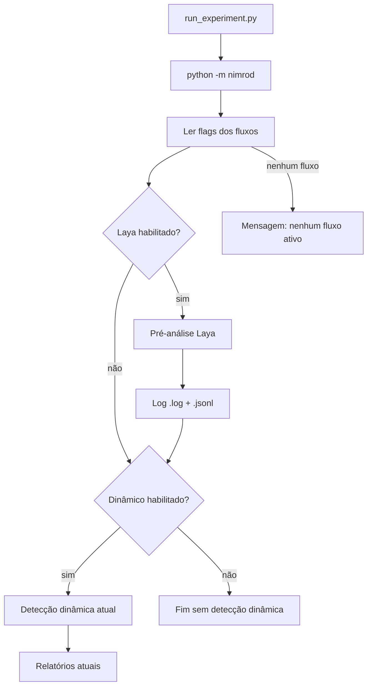

# Fluxo de pré-análise com Laya

Este documento descreve o fluxo opcional que roda **antes** da detecção
dinâmica do SMAT, usa o modelo de decisão **Laya** e registra hipóteses sobre os
três critérios de interferência de estado apresentados no artigo
`InterferenceSemanticConflicts.pdf`.

## 1. Papel do fluxo

O Laya é um encoder local que responde perguntas tipadas sobre um estado
(texto ou JSON) em um único forward pass. Ele **não executa código**, não
calcula valores de estado e não observa o comportamento real das versões
`base`, `left`, `right` e `merge`.

Por isso, neste projeto o Laya é usado como **gerador de hipóteses de
triagem**, não como oráculo:

- ele levanta quais critérios são plausíveis a partir do código e dos resumos
  de mudança;
- a detecção baseada em execução de testes continua sendo a autoridade;
- o fluxo nunca cria um conflito definitivo sozinho;
- probabilidades e decisões ficam registradas para análise posterior.

Essa separação segue a regra de projeto do documento *Laya no SMAT: triagem e
julgamento de interferência*: a Laya não deve introduzir falsos positivos que o
SMAT não produziria.

## 2. Os três critérios

Os três critérios abaixo são as condições concretas de estado do artigo
(páginas 33, 36 e 39). A formulação do artigo em termos de efeitos ("Merge tem
novos efeitos além dos de L e R") é equivalente ao critério 3 e está incluída
na descrição dele.

| ID | Critério | Definição | Pergunta ao Laya |
|---|---|---|---|
| `criterion_1_global_divergence` | Divergência global | Existe um state element `x` tal que `B`, `L` e `R` calculam valores diferentes entre si para `x`. | `noul`: há evidência de divergência pairwise entre base, left e right? |
| `criterion_2_parent_change_loss` | Perda de alteração do pai | Existe um state element `x` tal que `L` (ou `R`) calcula um valor diferente de `B` e de `Merge` para `x`. | `noul`: o merge deixou de preservar uma mudança de um dos pais? |
| `criterion_3_merge_new_effect` | Efeito colateral inesperado do merge | Existe um state element `x` tal que `B`, `L` e `R` calculam o mesmo valor, mas `Merge` calcula um valor diferente. | `noul`: o merge introduziu um efeito novo além dos efeitos de L e R? |

O fluxo também pergunta:

| ID | Primitiva | Uso |
|---|---|---|
| `primary_criterion` | `choice` | Critério mais forte entre os três (ou `none`). |
| `affected_branch` | `choice` | `left`, `right`, `both` ou `unclear`. |
| `analysis_confidence` | `score` | Confiança ordinal: `very low`, `low`, `medium`, `high`, `very high`. |

Um critério é marcado como `triggered` quando sua probabilidade `noul` é maior
ou igual a `SMAT_LAYA_THRESHOLD` (padrão `0.5`). A probabilidade é registrada
mesmo quando o critério não é acionado, para permitir análises de calibração.

## 3. Ordem de execução



A ordem é garantida por `nimrod/pipeline.py`: para cada cenário com
`runAnalysis=true`, o `laya_flow.run_for_scenario(scenario)` é chamado antes de
`smat.run_tool_for_semmantic_conflict_detection(scenario)`.

## 4. Estado enviado ao Laya

Para cada classe e método-alvo, o fluxo monta um estado compacto:

```json
{
  "project": "Project",
  "class": "org.example.Foo",
  "method": "value",
  "method_signature": "value(int)",
  "jar_type": "transformed",
  "left_changes_summary": "...",
  "right_changes_summary": "...",
  "versions": {
    "base": {
      "path": ".../source/Foo_base.java",
      "fields": ["private int x;"],
      "constructors": ["public Foo() {}"],
      "method": "public int value(int y) { ... }"
    },
    "left": { "...": "..." },
    "right": { "...": "..." },
    "merge": { "...": "..." }
  }
}
```

- A descoberta dos fontes reutiliza `nimrod/source_code.py`, o mesmo resolvedor
  do gerador LLM (`<Classe>_<branch>.java`, `<Classe>/<branch>.java`,
  `<branch>.java` ou `<Classe>.java`).
- A extração de campos, construtores e corpo do método usa Tree-sitter e a
  mesma query do gerador LLM.
- Versões ausentes ou com erro de extração são registradas em
  `missing_branches`; o fluxo continua com o que estiver disponível.
- O estado não é copiado para o log; o log guarda apenas um `state_digest`
  SHA-256 e os caminhos dos fontes.

## 5. Configuração

| Variável | Padrão | Descrição |
|---|---|---|
| `SMAT_LAYA_INTERFERENCE_DETECTION` | `false` | Liga/desliga o fluxo Laya. |
| `SMAT_LAYA_MODEL` | `english` | `english`, `multilingual` ou `typed-decisions`. |
| `SMAT_LAYA_THRESHOLD` | `0.5` | Limiar de probabilidade para `triggered`. |
| `SMAT_LAYA_MAX_LEN` | `512` | Limite de tokens do estado; o modelo pode truncar. |
| `SMAT_LAYA_LOG_DIR` | `.../reports/laya` | Diretório dos logs. |

O fluxo dinâmico continua controlado por
`SMAT_DYNAMIC_INTERFERENCE_DETECTION` (padrão `true`). As duas flags são
independentes:

| Dinâmico | Laya | Comportamento |
|---|---|---|
| `true` | `false` | Apenas detecção dinâmica. |
| `false` | `true` | Apenas pré-análise Laya. |
| `true` | `true` | Laya primeiro, depois detecção dinâmica. |
| `false` | `false` | Nenhum fluxo; mensagem de que nenhum está ativo. |

## 6. Instalação do Laya

O Laya é uma dependência opcional e pesada (torch/transformers). Instale:

```bash
python -m pip install -r SMAT/requirements-laya.txt
```

Para ambientes somente CPU, pode ser útil instalar o torch CPU antes:

```bash
python -m pip install torch --index-url https://download.pytorch.org/whl/cpu
python -m pip install -r SMAT/requirements-laya.txt
```

No Docker:

```bash
INSTALL_LAYA=true USER_ID=$(id -u) GROUP_ID=$(id -g) \
  docker compose build smat
```

O Dockerfile instala **torch CPU** por padrão (`TORCH_INDEX_URL`) para evitar
uma imagem CUDA desnecessária; use outro índice se tiver GPU. O
`requirements-laya.txt` fixa `transformers>=4.48,<4.52`, combinação validada
com `laya 0.4.12` em um smoke test live (torch 2.15 CPU + transformers 4.51.3,
`max_len=1024`, ~9 s). Se a inferência estiver lenta no CPU, reduza
`SMAT_LAYA_MAX_LEN` para `1024` (ou `512` no modelo `english`).

### 6.1 Python 3.11.0rc1 no Ubuntu 22.04

Se o log mostrar:

```text
error: Duplicate dispatch rule for <built-in function intern>: already registered in VariableBuilder's id dispatch map
```

a causa **não é o Laya nem uma interferência detectada**. O `python3.11` do
Ubuntu 22.04 é a versão **3.11.0rc1**, que não possui
`sys.get_int_max_str_digits`. O `torch._dynamo` registra `sys.intern` e depois
falha nesse atributo; o módulo é descartado, mas o registro permanece e o
próximo import mostra o erro de "Duplicate dispatch rule", mascarando a causa
real.

O `docker/Dockerfile` deste repositório agora instala Python 3.11 pelo PPA
`deadsnakes` e falha no build se detectar o rc1. Reconstrua a imagem sem cache:

```bash
INSTALL_LAYA=true USER_ID=$(id -u) GROUP_ID=$(id -g) \
  docker compose build --no-cache smat
```

Confirme a versão dentro do container:

```bash
docker compose run --rm smat python3 -VV
docker compose run --rm smat python3 -c \
  "import sys; print(hasattr(sys, 'get_int_max_str_digits'))"
```

O esperado é uma versão final (por exemplo `3.11.15`) e `True`. Se o erro
persistir, verifique também a combinação `transformers>=4.52` com
`torch<2.7.1`; nesse caso, use `transformers<4.52` ou `torch>=2.7.1`.

### 6.2 Cache e download do checkpoint

O primeiro `predict` baixa o checkpoint do Hugging Face. O `docker-compose.yml`
monta o diretório host `HF_CACHE_DIR` (padrão
`/home/arthur/.cache/huggingface`) em `/home/appuser/.cache/huggingface`, então
os pesos persistem entre execuções.

Variáveis relevantes:

- `HF_CACHE_DIR`: diretório host do cache.
- `HF_HUB_DISABLE_XET=1` (padrão): evita o caminho Xet, que pode travar em
  alguns ambientes Docker/rede.
- `HF_HUB_DOWNLOAD_TIMEOUT=120` e `HF_HUB_ETAG_TIMEOUT=30`: limites para não
  ficar indefinidamente esperando o Hub.
- `HF_HUB_OFFLINE=1`: depois do primeiro download bem-sucedido, use somente o
  cache e evite novas checagens no Hub.

Se o console parar em `Download complete`/`Reconstruction complete` com
`0.00B`, o processo está no download do checkpoint, não na análise. Verifique
espaço em disco:

```bash
df -h
docker system df
```

Se o pacote não estiver instalado ou o checkpoint não puder ser carregado, o
fluxo registra o erro no console e no log, mas **não interrompe** a detecção
dinâmica. O log inclui o traceback completo na primeira ocorrência de cada erro.

## 7. Logs

Cada execução cria dois arquivos em `SMAT/output-test-dest/reports/laya/`:

```text
laya_interference_<run_id>.log
laya_interference_<run_id>.jsonl
```

### 7.1 Log legível

Exemplo de bloco por método:

```text
[2026-10-20T19:00:00] Project :: org.example.Foo.value
  jar_type=transformed method_signature='value(int)'
  state_digest=...
  sources: base=/.../Foo_base.java left=/.../Foo_left.java right=/.../Foo_right.java merge=/.../Foo_merge.java
  missing_branches=-
  criterion_1_global_divergence: p=0.9123 threshold=0.50 -> TRIGGERED
    definition: Existe um state element x tal que B, L e R calculam valores diferentes entre si para x.
  criterion_2_parent_change_loss: p=0.4210 threshold=0.50 -> not-triggered
    definition: Existe um state element x tal que L (ou R) calcula um valor diferente de B e de Merge para x.
  criterion_3_merge_new_effect: p=0.1200 threshold=0.50 -> not-triggered
    definition: Existe um state element x tal que B, L e R calculam o mesmo valor para x, mas Merge calcula um valor diferente.
  primary_criterion: criterion_1_global_divergence (confidence=0.7700)
  affected_branch: left (confidence=0.6600)
  analysis_confidence: 3.2000 (high)
  triggered_criteria: criterion_1_global_divergence
  routing: {"model": "english"}
  usage: {"state_tokens": 120, "truncated": false}
```

### 7.2 JSONL

Cada linha do `.jsonl` é um objeto com:

- identificação: `timestamp`, `project`, `class`, `method`, `method_signature`,
  `jar_type`, `model`, `threshold`, `max_len`, `state_digest`;
- evidência: `source_paths`, `missing_branches`;
- resultados: `criteria`, `triggered_criteria`, `primary_criterion`,
  `primary_criterion_confidence`, `affected_branch`,
  `affected_branch_confidence`, `confidence_score`, `confidence_label`;
- diagnóstico: `routing`, `usage`, `answers` (payload bruto do Laya), `error`.

O campo `answers` preserva as probabilidades e distribuições originais para
análises de calibração e comparação entre execuções.

## 8. Limitações

- O Laya não executa código; os critérios são hipóteses sobre o texto, não
  observações de estado.
- A extração por Tree-sitter casa métodos pelo nome, não pela assinatura
  completa; métodos sobrecarregados podem ser confundidos.
- Estados longos podem ser truncados. O campo `usage.truncated` indica isso.
- Os resumos `leftChangesSummary`/`rightChangesSummary` são manuais no input
  atual; a qualidade deles afeta as respostas.
- A calibração do Laya não foi validada especificamente para código Java.
- O fluxo Laya não altera a taxa de compilação nem corrige testes.

## 9. Validação

Testes focados (não baixam pesos e usam um cliente Laya falso):

```bash
cd SMAT
PYTHONPATH="$PWD" python3 -m unittest -v \
  nimrod.tests.test_laya_interference \
  nimrod.tests.test_pipeline \
  nimrod.tests.test_source_code
```

## 10. Referências

- `InterferenceSemanticConflicts.pdf` — artigo base dos três critérios.
- *Laya no SMAT: triagem e julgamento de interferência* — proposta de uso do
  Laya como componente de decisão.
- Pacote Laya: <https://pypi.org/project/laya/> — documentação oficial.
- `SMAT/nimrod/laya_interference/criteria.py`
- `SMAT/nimrod/laya_interference/source_context.py`
- `SMAT/nimrod/laya_interference/flow.py`
- `SMAT/nimrod/pipeline.py`
