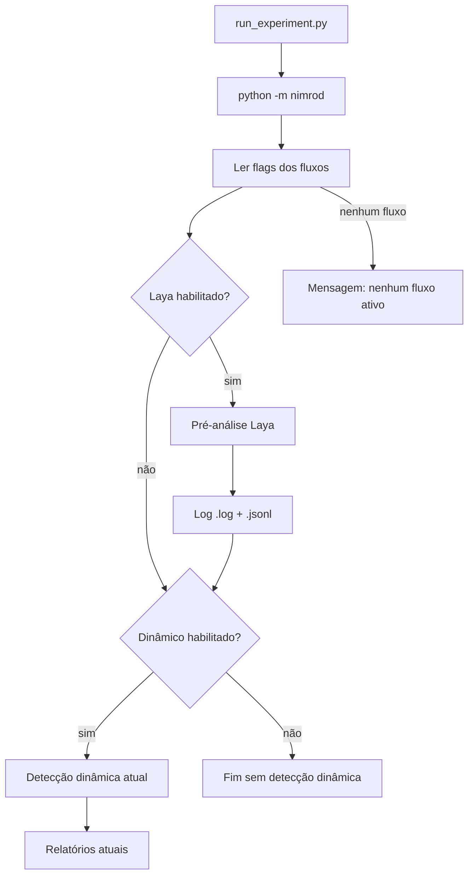

# Fluxo de pré-análise com Laya

Este documento descreve o fluxo opcional que roda **antes** da detecção
dinâmica do SMAT, usa o modelo de decisão **Laya** e registra hipóteses sobre os
três critérios de interferência de estado apresentados no artigo
`InterferenceSemanticConflicts.pdf`.

## 1. Papel do fluxo

O Laya é um encoder local que responde perguntas tipadas sobre um estado
(texto ou JSON) em um único forward pass. Ele **não executa código**, não
calcula valores de estado e não observa o comportamento real das versões
`base`, `left`, `right` e `merge`.

Por isso, neste projeto o Laya é usado como **gerador de hipóteses de
triagem**, não como oráculo:

- ele levanta quais critérios são plausíveis a partir do código e dos resumos
  de mudança;
- a detecção baseada em execução de testes continua sendo a autoridade;
- o fluxo nunca cria um conflito definitivo sozinho;
- probabilidades e decisões ficam registradas para análise posterior.

Essa separação segue a regra de projeto do documento *Laya no SMAT: triagem e
julgamento de interferência*: a Laya não deve introduzir falsos positivos que o
SMAT não produziria.

## 2. Os três critérios

Os três critérios abaixo são as condições concretas de estado do artigo
(páginas 33, 36 e 39). A formulação do artigo em termos de efeitos ("Merge tem
novos efeitos além dos de L e R") é equivalente ao critério 3 e está incluída
na descrição dele.

| ID | Critério | Definição | Pergunta ao Laya |
|---|---|---|---|
| `criterion_1_global_divergence` | Divergência global | Existe um state element `x` tal que `B`, `L` e `R` calculam valores diferentes entre si para `x`. | `noul`: há evidência de divergência pairwise entre base, left e right? |
| `criterion_2_parent_change_loss` | Perda de alteração do pai | Existe um state element `x` tal que `L` (ou `R`) calcula um valor diferente de `B` e de `Merge` para `x`. | `noul`: o merge deixou de preservar uma mudança de um dos pais? |
| `criterion_3_merge_new_effect` | Efeito colateral inesperado do merge | Existe um state element `x` tal que `B`, `L` e `R` calculam o mesmo valor, mas `Merge` calcula um valor diferente. | `noul`: o merge introduziu um efeito novo além dos efeitos de L e R? |

O fluxo também pergunta:

| ID | Primitiva | Uso |
|---|---|---|
| `primary_criterion` | `choice` | Critério mais forte entre os três (ou `none`). |
| `affected_branch` | `choice` | `left`, `right`, `both` ou `unclear`. |
| `analysis_confidence` | `score` | Confiança ordinal: `very low`, `low`, `medium`, `high`, `very high`. |

Um critério é marcado como `triggered` quando sua probabilidade `noul` é maior
ou igual a `SMAT_LAYA_THRESHOLD` (padrão `0.5`). A probabilidade é registrada
mesmo quando o critério não é acionado, para permitir análises de calibração.

## 3. Ordem de execução



A ordem é garantida por `nimrod/pipeline.py`: para cada cenário com
`runAnalysis=true`, o `laya_flow.run_for_scenario(scenario)` é chamado antes de
`smat.run_tool_for_semmantic_conflict_detection(scenario)`.

## 4. Estado enviado ao Laya

Para cada classe e método-alvo, o fluxo monta um estado compacto:

```json
{
  "project": "Project",
  "class": "org.example.Foo",
  "method": "value",
  "method_signature": "value(int)",
  "jar_type": "transformed",
  "left_changes_summary": "...",
  "right_changes_summary": "...",
  "versions": {
    "base": {
      "path": ".../source/Foo_base.java",
      "fields": ["private int x;"],
      "constructors": ["public Foo() {}"],
      "method": "public int value(int y) { ... }"
    },
    "left": { "...": "..." },
    "right": { "...": "..." },
    "merge": { "...": "..." }
  }
}
```

- A descoberta dos fontes reutiliza `nimrod/source_code.py`, o mesmo resolvedor
  do gerador LLM (`<Classe>_<branch>.java`, `<Classe>/<branch>.java`,
  `<branch>.java` ou `<Classe>.java`).
- A extração de campos, construtores e corpo do método usa Tree-sitter e a
  mesma query do gerador LLM.
- Versões ausentes ou com erro de extração são registradas em
  `missing_branches`; o fluxo continua com o que estiver disponível.
- O estado não é copiado para o log; o log guarda apenas um `state_digest`
  SHA-256 e os caminhos dos fontes.

## 5. Configuração

| Variável | Padrão | Descrição |
|---|---|---|
| `SMAT_LAYA_INTERFERENCE_DETECTION` | `false` | Liga/desliga o fluxo Laya. |
| `SMAT_LAYA_MODEL` | `english` | `english`, `multilingual` ou `typed-decisions`. |
| `SMAT_LAYA_THRESHOLD` | `0.5` | Limiar global de probabilidade para `triggered`. |
| `SMAT_LAYA_THRESHOLDS` | vazio | Três limiares por critério (`C1,C2,C3`); vazio usa o global. |
| `SMAT_LAYA_DECISION_RULE` | `baseline` | `baseline`, `consistent` ou `conservative`. |
| `SMAT_LAYA_STATE_FORMAT` | `json` | `json` (estado atual) ou `compact` (formato de treino). |
| `SMAT_LAYA_WITNESS` | `false` | Adiciona a pergunta `choice` de testemunha. |
| `SMAT_LAYA_WITNESS_TWO_STAGE` | `false` | Executa a testemunha em uma chamada separada antes dos critérios. |
| `SMAT_LAYA_MAX_LEN` | `512` | Limite de tokens do estado; o modelo pode truncar. |
| `SMAT_LAYA_LOG_DIR` | `.../reports/laya` | Diretório dos logs. |

O perfil calibrado no probe com `v3/base` usa `SMAT_LAYA_THRESHOLD=0.91`
(ou `SMAT_LAYA_THRESHOLDS=0.91,0.91,0.91`): no conjunto rotulado ele elevou a
precisão de 0.484 para 0.517 mantendo recall 1.0. Esse é o ponto de operação
atual do `.env`; ele ainda não elimina todos os falsos positivos de spring-boot,
por isso a regra `consistent`/`conservative` e o estado compacto ficam
disponíveis para os próximos experimentos.

O diretório precisa ficar sob `SMAT/output-test-dest` para que o viewer o leia.
No Docker, use `/app/SMAT/output-test-dest/reports/laya`. Sem a variável, o
default é `<cwd>/output-test-dest/reports/laya` (com `cwd` em `SMAT`).

O fluxo dinâmico continua controlado por
`SMAT_DYNAMIC_INTERFERENCE_DETECTION` (padrão `true`). As duas flags são
independentes:

| Dinâmico | Laya | Comportamento |
|---|---|---|
| `true` | `false` | Apenas detecção dinâmica. |
| `false` | `true` | Apenas pré-análise Laya. |
| `true` | `true` | Laya primeiro, depois detecção dinâmica. |
| `false` | `false` | Nenhum fluxo; mensagem de que nenhum está ativo. |

## 6. Instalação do Laya

O Laya é uma dependência opcional e pesada (torch/transformers). Instale:

```bash
python -m pip install -r SMAT/requirements-laya.txt
```

Para ambientes somente CPU, pode ser útil instalar o torch CPU antes:

```bash
python -m pip install torch --index-url https://download.pytorch.org/whl/cpu
python -m pip install -r SMAT/requirements-laya.txt
```

No Docker:

```bash
INSTALL_LAYA=true USER_ID=$(id -u) GROUP_ID=$(id -g) \
  docker compose build smat
```

O Dockerfile instala **torch CPU** por padrão (`TORCH_INDEX_URL`) para evitar
uma imagem CUDA desnecessária; use outro índice se tiver GPU. O
`requirements-laya.txt` fixa `transformers>=4.48,<4.52`, combinação validada
com `laya 0.4.12` em um smoke test live (torch 2.15 CPU + transformers 4.51.3,
`max_len=1024`, ~9 s). Se a inferência estiver lenta no CPU, reduza
`SMAT_LAYA_MAX_LEN` para `1024` (ou `512` no modelo `english`).

### 6.1 Python 3.11.0rc1 no Ubuntu 22.04

Se o log mostrar:

```text
error: Duplicate dispatch rule for <built-in function intern>: already registered in VariableBuilder's id dispatch map
```

a causa **não é o Laya nem uma interferência detectada**. O `python3.11` do
Ubuntu 22.04 é a versão **3.11.0rc1**, que não possui
`sys.get_int_max_str_digits`. O `torch._dynamo` registra `sys.intern` e depois
falha nesse atributo; o módulo é descartado, mas o registro permanece e o
próximo import mostra o erro de "Duplicate dispatch rule", mascarando a causa
real.

O `docker/Dockerfile` deste repositório agora instala Python 3.11 pelo PPA
`deadsnakes` e falha no build se detectar o rc1. Reconstrua a imagem sem cache:

```bash
INSTALL_LAYA=true USER_ID=$(id -u) GROUP_ID=$(id -g) \
  docker compose build --no-cache smat
```

Confirme a versão dentro do container:

```bash
docker compose run --rm smat python3 -VV
docker compose run --rm smat python3 -c \
  "import sys; print(hasattr(sys, 'get_int_max_str_digits'))"
```

O esperado é uma versão final (por exemplo `3.11.15`) e `True`. Se o erro
persistir, verifique também a combinação `transformers>=4.52` com
`torch<2.7.1`; nesse caso, use `transformers<4.52` ou `torch>=2.7.1`.

### 6.2 Cache e download do checkpoint

O primeiro `predict` baixa o checkpoint do Hugging Face. O `docker-compose.yml`
monta o diretório host `HF_CACHE_DIR` (padrão
`/home/arthur/.cache/huggingface`) em `/home/appuser/.cache/huggingface`, então
os pesos persistem entre execuções.

Variáveis relevantes:

- `HF_CACHE_DIR`: diretório host do cache.
- `HF_HUB_DISABLE_XET=1` (padrão): evita o caminho Xet, que pode travar em
  alguns ambientes Docker/rede.
- `HF_HUB_DOWNLOAD_TIMEOUT=120` e `HF_HUB_ETAG_TIMEOUT=30`: limites para não
  ficar indefinidamente esperando o Hub.
- `HF_HUB_OFFLINE=1`: depois do primeiro download bem-sucedido, use somente o
  cache e evite novas checagens no Hub.

Se o console parar em `Download complete`/`Reconstruction complete` com
`0.00B`, o processo está no download do checkpoint, não na análise. Verifique
espaço em disco:

```bash
df -h
docker system df
```

Se o pacote não estiver instalado ou o checkpoint não puder ser carregado, o
fluxo registra o erro no console e no log, mas **não interrompe** a detecção
dinâmica. O log inclui o traceback completo na primeira ocorrência de cada erro.

## 7. Logs

Cada execução cria dois arquivos em `SMAT/output-test-dest/reports/laya/`:

```text
laya_interference_<run_id>.log
laya_interference_<run_id>.jsonl
```

### 7.1 Log legível

Exemplo de bloco por método:

```text
[2026-10-20T19:00:00] Project :: org.example.Foo.value
  jar_type=transformed method_signature='value(int)'
  state_digest=...
  sources: base=/.../Foo_base.java left=/.../Foo_left.java right=/.../Foo_right.java merge=/.../Foo_merge.java
  missing_branches=-
  criterion_1_global_divergence: p=0.9123 threshold=0.50 -> TRIGGERED
    definition: Existe um state element x tal que B, L e R calculam valores diferentes entre si para x.
  criterion_2_parent_change_loss: p=0.4210 threshold=0.50 -> not-triggered
    definition: Existe um state element x tal que L (ou R) calcula um valor diferente de B e de Merge para x.
  criterion_3_merge_new_effect: p=0.1200 threshold=0.50 -> not-triggered
    definition: Existe um state element x tal que B, L e R calculam o mesmo valor para x, mas Merge calcula um valor diferente.
  primary_criterion: criterion_1_global_divergence (confidence=0.7700)
  affected_branch: left (confidence=0.6600)
  analysis_confidence: 3.2000 (high)
  triggered_criteria: criterion_1_global_divergence
  routing: {"model": "english"}
  usage: {"state_tokens": 120, "truncated": false}
```

### 7.2 JSONL

Cada linha do `.jsonl` é um objeto com:

- identificação: `timestamp`, `project`, `class`, `method`, `method_signature`,
  `jar_type`, `model`, `threshold`, `max_len`, `state_digest`;
- evidência: `source_paths`, `missing_branches`;
- resultados: `criteria`, `triggered_criteria`, `primary_criterion`,
  `primary_criterion_confidence`, `affected_branch`,
  `affected_branch_confidence`, `confidence_score`, `confidence_label`;
- diagnóstico: `routing`, `usage`, `answers` (payload bruto do Laya), `error`.

O campo `answers` preserva as probabilidades e distribuições originais para
análises de calibração e comparação entre execuções.

## 8. Limitações

- O Laya não executa código; os critérios são hipóteses sobre o texto, não
  observações de estado.
- A extração por Tree-sitter casa métodos pelo nome, não pela assinatura
  completa; métodos sobrecarregados podem ser confundidos.
- Estados longos podem ser truncados. O campo `usage.truncated` indica isso.
- Os resumos `leftChangesSummary`/`rightChangesSummary` são manuais no input
  atual; a qualidade deles afeta as respostas.
- A calibração do Laya não foi validada especificamente para código Java.
- O fluxo Laya não altera a taxa de compilação nem corrige testes.

## 9. Validação

Testes focados (não baixam pesos e usam um cliente Laya falso):

```bash
cd SMAT
PYTHONPATH="$PWD" python3 -m unittest -v \
  nimrod.tests.test_laya_interference \
  nimrod.tests.test_pipeline \
  nimrod.tests.test_source_code
```

## 10. Plano de melhoria — escopo Laya-only

Este plano tem como objetivo melhorar a classificação usando **somente o modelo
Laya**. Nenhuma etapa abaixo chama o fluxo LLM, combina probabilidades de LLM
ou usa o LLM como parte da decisão. A comparação com a detecção dinâmica e com
os rótulos do dataset serve apenas como referência externa de avaliação.

### 10.1 Escopo e não escopo

**Escopo atual**

- Melhorar a precisão e a calibração do fluxo Laya.
- Reduzir falsos positivos sem destruir os casos positivos que o Laya consegue
  identificar.
- Produzir uma classificação Laya auditável: critério, evidência/testemunha,
  probabilidade, confiança e eventual abstenção.
- Avaliar o Laya contra rótulos conhecidos do `dataset-sintetico` e contra os
  cenários spring-boot usados como casos de controle.

**Fora de escopo**

- Ensemble Laya + LLM.
- Usar LLM para desempatar, confirmar ou justificar uma decisão do Laya.
- Substituir a detecção baseada em execução.
- Alterar o fluxo LLM existente.

### 10.2 Linha de base observada

Na execução `20261031_231148_845202`, o Laya classificou **13 de 13**
cenários como `possible_interference`. Os cenários spring-boot
`TomcatEmbeddedServletContainerFactory.customizeConnector`,
`MongoProperties.builder` e
`SpringBootServletInitializer.createRootApplicationContext` são casos de
controle sem interferência, mas receberam:

| Método | C1 | C2 | C3 | `primary_criterion` |
|---|---:|---:|---:|---|
| `customizeConnector` | 0.821 | 0.856 | 0.909 | `none` (`P(none)=0.971`) |
| `builder` | 0.855 | 0.872 | 0.858 | `none` (`P(none)=0.986`) |
| `createRootApplicationContext` | 0.805 | 0.898 | 0.917 | `none` (`P(none)=0.965`) |

O estado desses cenários teve 2.328–2.962 tokens, sem truncamento
(`truncated=false`) com `max_len=4000`. Portanto, nesses casos o problema
**não** é falta de espaço no contexto.

O padrão se repete nos 13 cenários: todos os `noul` ficam acima do threshold
`0.70`, todos os `primary_criterion` retornam `none` e a classificação atual
considera qualquer critério acionado como interferência. O fluxo ignora
`primary_criterion`, `P(none)` e `analysis_confidence`.

Já existem artefatos de calibração no repositório que devem ser usados antes de
qualquer nova execução: `dataset-sintetico/resultados/probe_formats.json`
(rótulos) e `dataset-sintetico/resultados/probe_t1.json` (variantes `v1`, `v2`,
`v3`, `v1pt`, `v3pt`, cada uma em `base` e `ajustado`). A variante `v3/base`
reproduz o comportamento atual — probabilidades altas mesmo nos casos `No`
(ex.: `n01` com C1=0.792, C2=0.975, C3=0.930). A variante `v3/ajustado` reduz
os falsos positivos (o mesmo `n01` cai para 0.162/0.144/0.192), mas também
rebaixa vários positivos (ex.: `c2a` C2 cai de 0.989 para 0.135). Portanto,
trocar apenas o prompt/estado não basta: a melhora precisa ser acompanhada de
uma regra de decisão calibrada por critério que preserve o recall.

### 10.3 Diagnóstico priorizado

1. **Regra de decisão permissiva**: `possible_interference` é emitido quando
   qualquer `noul >= threshold`. Três probabilidades altas e correlacionadas
   são tratadas como três evidências independentes.
2. **Ausência de testemunha**: as perguntas atuais perguntam se “há
   evidência”, mas não exigem um `state element x` concreto com valores em
   B, L, R e Merge.
3. **Contradição não tratada**: o modelo responde `none` para o critério
   principal com 96–99% de probabilidade e, ao mesmo tempo, marca C1/C2/C3
   como verdadeiros. O fluxo não detecta essa inconsistência.
4. **Contexto ruidoso**: o estado envia todos os fields, construtores e o
   método de cada branch. Campos e construtores irrelevantes podem ser
   interpretados como divergência semântica.
5. **Definições abstratas**: a diferença entre “mudança complementar
   preservada no merge” e “interferência” não está suficientemente explícita
   nas perguntas.
6. **Threshold global inadequado**: as distribuições dos casos positivos e
   negativos se sobrepõem; aumentar apenas `SMAT_LAYA_THRESHOLD` não separa os
   grupos.

### 10.4 Fases do plano

#### Fase 0 — Harness de avaliação e congelamento da linha de base

- Definir o gold standard a partir de `probe_formats.json`:
  - `label` em `Yes`, `No` ou `-`; casos `-` ficam fora das métricas;
  - `criteria` mapeia para `criterion_1_global_divergence` (C1),
    `criterion_2_parent_change_loss` (C2) e
    `criterion_3_merge_new_effect` (C3);
  - casos reais marcados `Yes` sem `criteria` valem como rótulo **por cenário**
    (interferência sim/não), não por critério.
- Criar um harness reproduzível:
  - flag/env para selecionar a variante de prompt/estado e a regra de decisão
    (ex.: `SMAT_LAYA_PROMPT_VARIANT` e `SMAT_LAYA_DECISION_RULE`);
  - testes offline com cliente Laya falso, para não baixar pesos;
  - relatório de métricas como artefato versionado (CSV/JSON), não apenas logs.
- Congelar o baseline = fluxo atual (`v3/base`, threshold 0.70, modelo
  `multilingual`, `max_len=4000`) e registrar por cenário:
  - probabilidades C1/C2/C3, `primary_criterion`, `P(none)`,
    `analysis_confidence`, `usage.state_tokens`, `usage.truncated`,
    classificação e erro.
- Métricas por cenário:
  - por critério: precisão, recall, F1 e falsos positivos;
  - classificação final: precisão, recall, F1, taxa de falso positivo e taxa de
    abstenção;
  - eficiência: `state_tokens`, `truncated`, tempo de inferência por método e
    número de forward passes.
- Nenhuma mudança de prompt, contexto, modelo ou threshold é avaliada sem
  comparar contra esse baseline.

#### Fase 1 — Regra de decisão e abstenção

- Deixar de classificar apenas por “qualquer critério acima do threshold”.
- Comparar, no conjunto de validação, as seguintes regras candidatas:
  1. `any noul >= t` (baseline atual);
  2. `primary_criterion != none` **e** `noul[primary_criterion] >= t`;
  3. `any noul >= t` **e** consistência entre `noul` e `primary_criterion`;
  4. testemunha concreta (Fase 3) seguida do `noul` do critério;
  5. abstenção quando `primary_criterion = none` com `P(none) >= alpha`, ou
     quando `max(noul)` ficar abaixo de um limite inferior.
- Escolher thresholds **por critério** com varredura maximizando o Youden `J`
  (sensibilidade + especificidade − 1) no conjunto de validação; não usar um
  único threshold global sem evidência.
- Tratar `uncertain` como terceiro estado, não como erro: medir precisão/recall
  excluindo as abstenções **e** a cobertura (fração não abstida), para não
  otimizar abstenção a ponto de esconder o problema.
- Proteger o recall: qualquer regra que elimine os falsos positivos de
  spring-boot mas derrube os positivos do sintético deve ser descartada.

#### Fase 2 — Compactação do estado

- Reutilizar `nimrod/context_filter.py` (flag `SMAT_CONTEXT_FILTER`) para manter
  apenas os fields usados pelo método ou tocados pelas mudanças, em vez de
  criar um novo filtro.
- Usar o formato compacto já exercitado no probe (`state_v1`): corpo do método,
  resumo das mudanças de L e R, atributos relevantes e construtores somente
  quando afetam o estado.
- Manter os resumos `leftChangesSummary`/`rightChangesSummary` explícitos; eles
  reduzem a ambiguidade entre mudança preservada e interferência.
- Comparar A/B contra o estado atual em precisão, recall, `state_tokens`,
  `truncated` e tempo de inferência.
- Só aumentar `SMAT_LAYA_MAX_LEN` se a compactação não for suficiente; o
  problema observado nos spring-boot não é truncamento.

#### Fase 3 — Redesenho das perguntas

- O Laya expõe apenas `noul`, `choice` e `score` (sem texto livre). A testemunha
  deve ser um `choice` entre candidatos derivados da AST: fields, retorno,
  parâmetros, efeitos observáveis ou `none`.
- Fazer a pergunta `noul` de cada critério somente para a testemunha escolhida.
- Explicitar as condições negativas:
  - C1 é falso se B e R são iguais e apenas L mudou;
  - C2 é falso se Merge preserva exatamente a mudança de L ou R;
  - C3 é falso se B, L e R não são todos iguais.
- Incluir contraexemplos de merge limpo, como mudanças complementares e
  preservadas.
- Preferir um único forward pass com as perguntas reestruturadas; testar a
  separação dos critérios em chamadas independentes somente depois da
  compactação do estado e apenas se a regra de decisão exigir.

#### Fase 4 — Modelo e parâmetros

- Comparar as variantes já registradas no probe (`v1`, `v2`, `v3` em `base` e
  `ajustado`) com `multilingual`, `english` e, se disponível, checkpoint
  fine-tuned.
- Avaliar `max_len` após a compactação; não assumir que aumentar o limite
  resolve o problema.
- Medir repetibilidade: repetir cada configuração mais de uma vez e registrar a
  variação das probabilidades.
- Calibrar thresholds por critério com validação cruzada (LOOCV ou k-fold,
  dada a amostra pequena); evitar overfitting aos 20 casos.
- Registrar também o custo de inferência de cada variante; variantes que
  precisem de mais forward passes só se justificam se melhorarem a métrica.

#### Fase 5 — Integração e apresentação

- Atualizar o log e o viewer para mostrar:
  - testemunha escolhida;
  - `P(none)` e `primary_criterion`;
  - `analysis_confidence`;
  - classificação final e motivo da abstenção.
- Manter `no_signal`, `possible_interference` e `uncertain` como estados
  distintos.
- Não alterar o fluxo LLM existente.

### 10.5 Ordem de prioridade

1. Fase 0: benchmark e baseline.
2. Fase 1: regra de decisão/abstenção.
3. Fase 2: compactação do estado.
4. Fase 3: redesenho das perguntas.
5. Fase 4: modelo e parâmetros.
6. Fase 5: integração e apresentação.

As fases 0 e 1 devem vir primeiro: sem uma regra de decisão calibrada, mudanças
de prompt ou de contexto não podem ser avaliadas de forma confiável.

### 10.6 Critérios de aceitação

- Os cenários spring-boot de controle sem interferência devem resultar em
  `no_signal` ou `uncertain`, nunca `possible_interference`.
- O recall dos casos positivos conhecidos deve atingir uma meta definida antes
  da calibração (por exemplo, ≥ 80% no conjunto de validação), sem zerar a
  precisão para alcançá-la.
- A classificação final deve registrar explicitamente a regra, os sinais que a
  produziram e, quando houver abstenção, o motivo.
- `uncertain` deve ter política documentada: métricas excluindo abstenções **e**
  cobertura; a abstenção não pode esconder falsos positivos/negativos.
- Nenhum passo pode chamar o LLM ou depender de saída do LLM.
- Eficiência: `state_tokens` e `truncated` devem ser medidos; nenhuma variante
  deve adicionar forward passes sem ganho de métrica correspondente.
- O fluxo atual permanece como default até a variante vencedora ser validada; a
  troca é feita por flag/env e é reversível.
- Métricas antes/depois devem ser registradas para cada fase.

### 10.7 Riscos e controles

- **Amostra pequena**: 31 casos rotulados (15 `Yes`, 16 `No`, 2 `-`) são
  insuficientes para uma calibração robusta; usar LOOCV/k-fold e reportar
  intervalos, não apenas médias.
- **Overfitting**: escolher thresholds com base em todos os casos e depois
  avaliar nos mesmos casos produz uma métrica otimista.
- **Qualidade do rótulo**: alguns casos reais `Yes` não têm `criteria`; validar
  a semântica do rótulo antes de usá-lo como verdade por critério.
- **Colapso de recall**: variantes `ajustado` reduzem falsos positivos mas
  também rebaixam positivos (ex.: `c2a` C2 0.989→0.135); exigir recall mínimo
  em todo experimento.
- **Variabilidade do modelo**: repetir execuções e registrar a distribuição das
  probabilidades.
- **Mudança de distribuição**: os casos sintéticos são menores que os projetos
  reais; validar também nos cenários spring-boot e não calibrar só no sintético.
- **Ausência de execução**: o Laya continua sendo uma aproximação; a detecção
  por execução permanece a referência final.

### 10.8 Fora de escopo: fluxo híbrido Laya + LLM

O fluxo híbrido é uma evolução separada, não faz parte deste plano e não deve
ser implementado como parte da melhoria do Laya. Quando existir, deve ser
ativado por uma variável de ambiente própria (por exemplo,
`SMAT_HYBRID_INTERFERENCE_DETECTION`) e consumir as saídas dos fluxos Laya e LLM
como componentes independentes. A flag `SMAT_LLM_INTERFERENCE_DETECTION`
continua controlando apenas o fluxo LLM atual.

### 10.9 Resultado do experimento live (2026-10-31)

Foi executada uma comparação live em 6 casos sintéticos (3 `No`, 3 `Yes`) com
o checkpoint base `multilingual`, `max_len=4000`, threshold `0.91`:

| Configuração | `No` possível | `No` inconclusivo | `Yes` possível | `Yes` inconclusivo |
|---|---:|---:|---:|---:|
| `baseline_json` | 3/3 | 0/3 | 3/3 | 0/3 |
| `compact_consistent` | 3/3 | 0/3 | 2/3 | 1/3 |
| `compact_consistent` + testemunha (2 chamadas) | 0/3 | 3/3 | 0/3 | 3/3 |

O estado compacto reduziu o payload e mudou as probabilidades, mas **não
eliminou os falsos positivos**: sem a testemunha, nos três casos `No` o
`primary_criterion` do modelo passou a apontar para um critério (C2 ou C3) e a
regra `consistent` aceitou a hipótese.

Com a pergunta de testemunha, os três `No` foram corretamente abstidos, mas os
três `Yes` **também** ficaram `uncertain` (o modelo escolheu `none` em 5/6
casos; no sexto escolheu `field:total` sem escolher um `primary_criterion`). A
variante de duas chamadas — testemunha isolada e depois critérios com a
testemunha fixada — produziu exatamente o mesmo resultado: 0/3 `No` e 0/3
`Yes` como positivos, todos `uncertain`.
Ou seja, a testemunha resolveu o falso positivo ao custo de zerar o recall na
amostra.

Conclusão: compactar o estado, trocar para `consistent` ou adicionar a
testemunha **isoladamente não é suficiente**. O `.env` permanece no perfil
medido (`baseline`, `json`, `0.91`, testemunha desligada) até que o próximo
experimento com checkpoint fine-tuned/prompt seja validado. O relatório está em
`docs/laya-live-compare.json`.


### 10.10 Instruções negativas por critério — A/B live

Foi executado um A/B no checkpoint fine-tuned, com 20 casos sintéticos e
thresholds `0.8/0.81/0.84`, comparando as perguntas antigas com as perguntas
que incluem as instruções negativas por critério. Não foi usado role genérico.

| Critério | Precisão antiga | Precisão nova | Recall antigo | Recall novo | F1 antigo | F1 novo |
|---|---:|---:|---:|---:|---:|---:|
| C1 | 0.5000 | 0.2727 | 0.7500 | 0.7500 | 0.6000 | 0.4000 |
| C2 | 0.4286 | 0.4286 | 0.6667 | 0.6667 | 0.5217 | 0.5217 |
| C3 | 0.1000 | 0.1818 | 0.2000 | 0.4000 | 0.1333 | 0.2500 |
| Final (qualquer critério) | 0.5000 | 0.5625 | 0.5833 | 0.7500 | 0.5385 | 0.6429 |

As instruções negativas melhoraram o **resultado final** (F1 0.5385 → 0.6429,
recall 0.5833 → 0.75), mas o efeito por critério é desigual:

- C1: recall preservado, mas precisão caiu (0.50 → 0.2727);
- C2: sem mudança;
- C3: recall/F1 melhoraram, porém a precisão continua baixa (0.1818).

Conclusão: as instruções são úteis como sinal agregado, mas não são uma melhoria
uniforme por critério. O próximo passo deve calibrar/ajustar C1 e C3
separadamente; o A/B está em `docs/laya-negative-ab.json`.

### 10.11 A/B das regras de decisão

Foi executado o A/B de `baseline`, `consistent` e `conservative` no checkpoint
fine-tuned retreinado com witness + primary, usando 20 casos sintéticos e
thresholds `0.8/0.81/0.84`.

| Regra | TP | FP | TN | FN | Precisão | Recall | F1 | Uncertain | Coverage |
|---|---:|---:|---:|---:|---:|---:|---:|---:|---:|
| `baseline` | 0 | 0 | 8 | 12 | 0.0000 | 0.0000 | 0.0000 | 0 | 1.00 |
| `consistent` | 0 | 0 | 8 | 12 | 0.0000 | 0.0000 | 0.0000 | 12 | 0.40 |
| `conservative` | 0 | 0 | 8 | 12 | 0.0000 | 0.0000 | 0.0000 | 19 | 0.05 |

Nenhuma regra produziu `possible_interference`: o checkpoint retreinado ficou
mais calibrado (ECE 0.6083 → 0.3828), porém as probabilidades `noul` ficaram
abaixo dos thresholds `0.8/0.81/0.84`; o `baseline` classificou todos como
`no_signal`, enquanto `consistent` e `conservative` absteram quase tudo.

Conclusão: o A/B das regras **não autoriza adotar** `consistent`/`conservative`
como default. O próximo passo é recalibrar os thresholds/confiança (ou revisar o
checkpoint) antes de repetir o A/B. O relatório está em
`docs/laya-decision-ab.json`.

## 11. Referências

- `InterferenceSemanticConflicts.pdf` — artigo base dos três critérios.
- *Laya no SMAT: triagem e julgamento de interferência* — proposta de uso do
  Laya como componente de decisão.
- Pacote Laya: <https://pypi.org/project/laya/> — documentação oficial.
- `SMAT/nimrod/laya_interference/criteria.py`
- `SMAT/nimrod/laya_interference/source_context.py`
- `SMAT/nimrod/laya_interference/flow.py`
- `SMAT/nimrod/pipeline.py`
