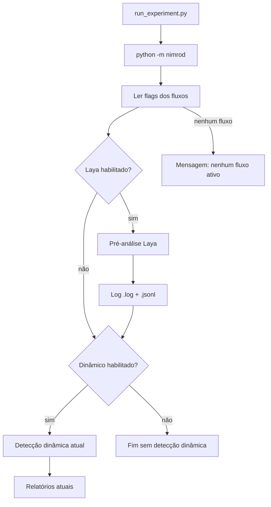

# Fluxo de pré-análise com Laya

Este documento descreve o fluxo opcional que roda **antes** da detecção
dinâmica do SMAT, usa o modelo de decisão **Laya** e registra hipóteses sobre os
três critérios de interferência de estado apresentados no artigo
`InterferenceSemanticConflicts.pdf`.

## 1. Papel do fluxo

O Laya é um encoder local que responde perguntas tipadas sobre um estado
(texto ou JSON) em um único forward pass. Ele **não executa código**, não
calcula valores de estado e não observa o comportamento real das versões
`base`, `left`, `right` e `merge`.

Por isso, neste projeto o Laya é usado como **gerador de hipóteses de
triagem**, não como oráculo:

- ele levanta quais critérios são plausíveis a partir do código e dos resumos
  de mudança;
- a detecção baseada em execução de testes continua sendo a autoridade;
- o fluxo nunca cria um conflito definitivo sozinho;
- probabilidades e decisões ficam registradas para análise posterior.

Essa separação segue a regra de projeto do documento *Laya no SMAT: triagem e
julgamento de interferência*: a Laya não deve introduzir falsos positivos que o
SMAT não produziria.

## 2. Os três critérios

Os três critérios abaixo são as condições concretas de estado do artigo
(páginas 33, 36 e 39). Os prompts usam as igualdades e desigualdades explícitas;
a descrição ampla de "efeitos novos" não substitui a condição do critério 3.

| ID | Critério | Definição | Pergunta ao Laya |
|---|---|---|---|
| `criterion_1_global_divergence` | Divergência global | Existe um state element `x` tal que `B`, `L` e `R` calculam valores diferentes entre si para `x`. | `noul`: há evidência de divergência pairwise entre base, left e right? |
| `criterion_2_parent_change_loss` | Perda de alteração do pai | Existe um state element `x` tal que `L` (ou `R`) calcula um valor diferente de `B` e de `Merge` para `x`. | `noul`: o merge deixou de preservar uma mudança de um dos pais? |
| `criterion_3_merge_new_effect` | Efeito colateral inesperado do merge | Existe um state element `x` tal que `B`, `L` e `R` calculam o mesmo valor, mas `Merge` calcula um valor diferente. | `noul`: o merge introduziu um efeito novo além dos efeitos de L e R? |

O fluxo também pergunta:

| ID | Primitiva | Uso |
|---|---|---|
| `primary_criterion` | `choice` | Diagnóstico bruto; o relatório deriva o critério principal dos escores válidos e acionados. |
| `affected_branch` | `choice` | `left`, `right`, `both`, `unclear` ou `not_applicable`. |
| `analysis_confidence` | `score` | Rubrica de completude da evidência; não representa probabilidade calibrada de acerto. |

Um critério só é marcado como `triggered` se as versões necessárias estiverem
disponíveis, a resposta for um número finito em `[0,1]`, a pergunta não tiver
contexto truncado reportado e o escore atingir seu limiar. O padrão continua
`SMAT_LAYA_THRESHOLD=0.5`, com sobrescritas opcionais por critério.

Os prompts `state-observables-v2` comparam a mesma observação, entrada externa e
sequência de operações, respeitando a inicialização de cada versão. O alvo pode
declarar `observations` e `observationContext`. Sem essa declaração, a política
compara campos, entradas de coleções, retornos e exceções individualmente, sem
agregar entradas independentes em uma diferença do objeto inteiro. Essa escolha
de granularidade é parte da definição do experimento.

## 3. Ordem de execução



A ordem é garantida por `nimrod/pipeline.py`: para cada cenário com
`runAnalysis=true`, o `laya_flow.run_for_scenario(scenario)` é chamado antes de
`smat.run_tool_for_semmantic_conflict_detection(scenario)`.

## 4. Estado enviado ao Laya

Para cada classe e método-alvo, o fluxo monta um estado compacto:

```json
{
  "observation_policy": "Use the same external inputs ...",
  "observations": ["return value"],
  "observation_context": "Call value(1) on a fresh instance in each version.",
  "method_signature": "value(int)",
  "left_changes_summary": "...",
  "right_changes_summary": "...",
  "versions": {
    "base": {
      "available": true,
      "error": null,
      "fields": ["private int x;"],
      "constructors": ["public Foo() {}"],
      "method": "public int value(int y) { ... }"
    },
    "left": { "...": "..." },
    "right": { "...": "..." },
    "merge": { "...": "..." }
  }
}
```

- A descoberta dos fontes reutiliza `nimrod/source_code.py`, o mesmo resolvedor
  do gerador LLM (`<Classe>_<branch>.java`, `<Classe>/<branch>.java`,
  `<branch>.java` ou `<Classe>.java`).
- A extração Laya usa Tree-sitter em modo estrito: classe e assinatura do alvo,
  rejeitando seleção ambígua. Inclui campos, construtores, inicializadores e
  métodos auxiliares alcançáveis da mesma classe. O gerador LLM conserva seu
  comportamento anterior de extração.
- Caminhos, projeto e tipo de JAR ficam nos relatórios, fora do contexto do modelo.
- Versões ausentes, corpo vazio, fonte reutilizado em versões distintas e erros
  de extração são registrados em `missing_branches`. C1 requer B/L/R; C2 e C3
  requerem também Merge. Perguntas sem essas versões não são enviadas.
- O estado não é copiado para o log; o log guarda apenas um `state_digest`
  SHA-256 e os caminhos dos fontes.

## 5. Configuração

| Variável | Padrão | Descrição |
|---|---|---|
| `SMAT_LAYA_INTERFERENCE_DETECTION` | `false` | Liga/desliga o fluxo Laya. |
| `SMAT_LAYA_MODEL` | `english` | `english`, `multilingual` ou `typed-decisions`. |
| `SMAT_LAYA_THRESHOLD` | `0.5` | Limiar de probabilidade para `triggered`. |
| `SMAT_LAYA_THRESHOLD_C1`, `..._C2`, `..._C3` | vazio | Limiar específico; vazio herda o global. |
| `SMAT_LAYA_QUESTION_FORMAT` | `noul` | `noul`, `noul_ab` ou `choice_ab`; alternativas para validação. |
| `SMAT_LAYA_MAX_LEN` | `512` | Orçamento total da sequência, incluindo pergunta/opções; pode truncar o estado. |
| `SMAT_LAYA_LOG_DIR` | `.../reports/laya` | Diretório dos logs. |

O fluxo dinâmico continua controlado por
`SMAT_DYNAMIC_INTERFERENCE_DETECTION` (padrão `true`). As duas flags são
independentes:

| Dinâmico | Laya | Comportamento |
|---|---|---|
| `true` | `false` | Apenas detecção dinâmica. |
| `false` | `true` | Apenas pré-análise Laya. |
| `true` | `true` | Laya primeiro, depois detecção dinâmica. |
| `false` | `false` | Nenhum fluxo; mensagem de que nenhum está ativo. |

## 6. Instalação do Laya

O Laya é uma dependência opcional e pesada (torch/transformers). Instale:

```bash
python -m pip install -r SMAT/requirements-laya.txt
```

Para ambientes somente CPU, pode ser útil instalar o torch CPU antes:

```bash
python -m pip install torch --index-url https://download.pytorch.org/whl/cpu
python -m pip install -r SMAT/requirements-laya.txt
```

No Docker:

```bash
INSTALL_LAYA=true USER_ID=$(id -u) GROUP_ID=$(id -g) \
  docker compose build smat
```

### 6.1 Python 3.11.0rc1 no Ubuntu 22.04

Se o log mostrar:

```text
error: Duplicate dispatch rule for <built-in function intern>: already registered in VariableBuilder's id dispatch map
```

a causa **não é o Laya nem uma interferência detectada**. O `python3.11` do
Ubuntu 22.04 é a versão **3.11.0rc1**, que não possui
`sys.get_int_max_str_digits`. O `torch._dynamo` registra `sys.intern` e depois
falha nesse atributo; o módulo é descartado, mas o registro permanece e o
próximo import mostra o erro de "Duplicate dispatch rule", mascarando a causa
real.

O `docker/Dockerfile` deste repositório agora instala Python 3.11 pelo PPA
`deadsnakes` e falha no build se detectar o rc1. Reconstrua a imagem sem cache:

```bash
INSTALL_LAYA=true USER_ID=$(id -u) GROUP_ID=$(id -g) \
  docker compose build --no-cache smat
```

Confirme a versão dentro do container:

```bash
docker compose run --rm smat python3 -VV
docker compose run --rm smat python3 -c \
  "import sys; print(hasattr(sys, 'get_int_max_str_digits'))"
```

O esperado é uma versão final (por exemplo `3.11.15`) e `True`. Se o erro
persistir, verifique também a combinação `transformers>=4.52` com
`torch<2.7.1`; nesse caso, use `transformers<4.52` ou `torch>=2.7.1`.

O primeiro `predict` baixa o checkpoint do Hugging Face. Se o pacote não estiver
instalado ou o checkpoint não puder ser carregado, o fluxo registra o erro no
console e no log, mas **não interrompe** a detecção dinâmica. O log inclui o
traceback completo na primeira ocorrência de cada erro.

## 7. Logs

Cada execução cria dois arquivos em `SMAT/output-test-dest/reports/laya/`:

```text
laya_interference_<run_id>.log
laya_interference_<run_id>.jsonl
```

### 7.1 Log legível

Exemplo de bloco por método:

```text
[2026-10-20T19:00:00] Project :: org.example.Foo.value
  jar_type=transformed method_signature='value(int)'
  state_digest=...
  sources: base=/.../Foo_base.java left=/.../Foo_left.java right=/.../Foo_right.java merge=/.../Foo_merge.java
  missing_branches=-
  criterion_1_global_divergence: p=0.9123 threshold=0.50 -> TRIGGERED
    definition: Existe um state element x tal que B, L e R calculam valores diferentes entre si para x.
  criterion_2_parent_change_loss: p=0.4210 threshold=0.50 -> not-triggered
    definition: Existe um state element x tal que L (ou R) calcula um valor diferente de B e de Merge para x.
  criterion_3_merge_new_effect: p=0.1200 threshold=0.50 -> not-triggered
    definition: Existe um state element x tal que B, L e R calculam o mesmo valor para x, mas Merge calcula um valor diferente.
  primary_criterion: criterion_1_global_divergence
  affected_branch: not_applicable
  analysis_confidence: 3.2000 (high)
  triggered_criteria: criterion_1_global_divergence
  routing: {"model": "english"}
  usage: {"state_tokens": 120, "truncated": false}
```

### 7.2 JSONL

Cada linha do `.jsonl` é um objeto com:

- identificação: `timestamp`, `project`, `class`, `method`, `method_signature`,
  `jar_type`, `model`, `threshold`, `max_len`, `state_digest`;
- evidência: `source_paths`, `missing_branches`;
- resultados: `criteria`, `triggered_criteria`, `primary_criterion`,
  `primary_criterion_confidence`, `affected_branch`,
  `affected_branch_confidence`, `confidence_score`, `confidence_label`;
- diagnóstico: `routing`, `usage`, `answers` (payload bruto do Laya), `error`.

O campo `answers` preserva as probabilidades e distribuições originais para
análises de calibração e comparação entre execuções.

O exemplo acima gera avisos: C1 tem escore superior a C2 apesar da implicação
lógica, e um diagnóstico de ramo perdido não é aceito quando C2 não dispara.
`primary_criterion_confidence` fica `null`: o critério principal é derivado, não
uma escolha cuja confiança possa ser copiada do modelo.

Os relatórios também incluem `prompt_version`, `question_format`,
`assessment_complete`, `warnings` e `criteria[id].status/reasons`. Estados:

- `possible_interference`: pelo menos um critério válido acionado; pode ser parcial.
- `no_signal`: os três critérios avaliados, nenhum acionado; não prova ausência.
- `insufficient_context`: nenhum sinal válido e comparação incompleta, inclusive
  resposta ausente/inválida (`invalid_response` no critério).
- `error`: falha técnica na construção ou execução da análise.

`usage.state_tokens`, `state_tokens_dropped` e `truncated_questions` vêm do Laya.
A contagem descartada é o pior caso entre perguntas, não uma contagem individual.
Se só houver um indicador global de truncamento, a abstenção é conservadora para
todas as perguntas. Telemetria ausente gera aviso, sem inventar uma contagem.
Diagnósticos truncados não alimentam os campos normalizados do relatório; as
respostas originais continuam em `answers`.

## 8. Limitações

- O Laya não executa código; os critérios são hipóteses sobre o texto, não
  observações de estado.
- A extração estrita não implementa toda a resolução de tipos e despacho Java.
  Dependências externas, herança e reflexão podem exigir contexto adicional.
- Estados longos podem ser truncados. As perguntas afetadas se abstêm; aumentar
  o orçamento deve ser avaliado por checkpoint, qualidade, cobertura e custo.
- Os resumos `leftChangesSummary`/`rightChangesSummary` são manuais no input
  atual; a qualidade deles afeta as respostas.
- A calibração do Laya não foi validada especificamente para código Java.
- O fluxo Laya não altera a taxa de compilação nem corrige testes.

## 9. Validação

Testes focados (não baixam pesos e usam um cliente Laya falso):

```bash
cd SMAT
PYTHONPATH="$PWD" python3 -m unittest -v \
  nimrod.tests.test_laya_interference \
  nimrod.tests.test_laya_quality \
  nimrod.tests.test_laya_classification \
  nimrod.tests.test_pipeline \
  nimrod.tests.test_source_code
```

Para comparação de modelos, formatos, orçamentos e limiares, e exportação de
treino no formato de produção, veja [laya-validacao.md](laya-validacao.md).

## 10. Referências

- `InterferenceSemanticConflicts.pdf` — artigo base dos três critérios.
- *Laya no SMAT: triagem e julgamento de interferência* — proposta de uso do
  Laya como componente de decisão.
- Pacote Laya: <https://pypi.org/project/laya/> — documentação oficial.
- `SMAT/nimrod/laya_interference/criteria.py`
- `SMAT/nimrod/laya_interference/source_context.py`
- `SMAT/nimrod/laya_interference/flow.py`
- `SMAT/nimrod/pipeline.py`
